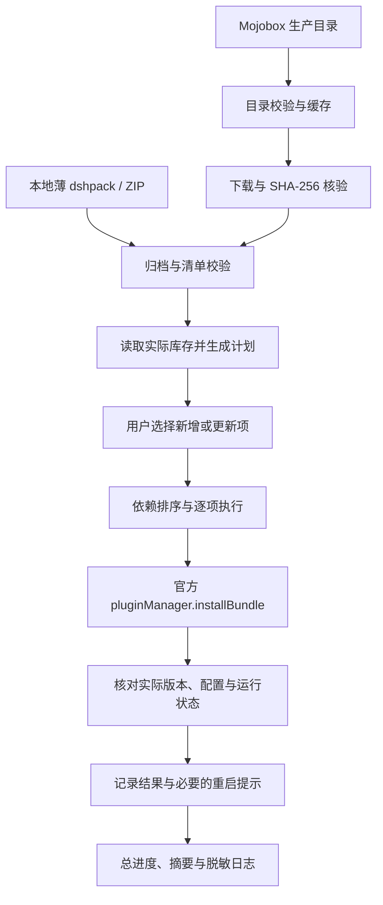

# Mojobox Installer 架构

本项目是官方 DeepSeek Harness 的设置页插件，包名为 `dsh-plugin-mojobox`。
目录和整合包内容由 [Mojobox 主仓库](https://github.com/lanyun077/EAC-mojobox)维护，
依赖解析、实际安装与运行由官方宿主提供。安装器只组织经用户确认的计划，不实现另一套插件运行时。

## 安装链路

核对更新先刷新远端目录，有新版则下载核验并生成新预览，无新版则明确提示并重新核对原目标。
失败项重试依据已有记录生成选择计划，不直接重放写入。提交时和每次写入前重新读取实际状态，避免预览后环境变化。

## 源码分工

| 模块 | 责任 |
| --- | --- |
| `src/client.ts` | 宿主 React 设置页；首页文件安装、市场、已安装更新提醒、组件卡片管理、请求反馈、总进度与日志入口 |
| `src/index.ts` | 宿主初始化、当前 Profile 接线、Connection 路由注册与请求边界 |
| `src/contracts.ts` | 实际使用的官方服务接口最小类型，不替代官方 SDK 定义 |
| `src/feature-pack.ts` | 内存读取 ZIP、Schema 与语义校验、尺寸和成员限制 |
| `src/catalog.ts` | 固定目录读取、版本身份、缓存、新版识别与归档一致性 |
| `src/artifacts.ts` | 解析宿主配置的注册表、精确产物、SHA-512 与 tarball 身份核验 |
| `src/manager.ts` | 库存分类、计划、选择执行、依赖关系、配置保护核验、记录与诊断 |
| `schema/feature-pack.json` | 主仓协议的本地副本，来源见同目录 README |
| `scripts/build.mjs` | TypeScript 转换及官方前端模块工厂输出到 `lib/` |

宿主从 `cordis.patch.yml` 注册 `lib/index.js`；客户端通过包导出 `./client` 加载，React 复用宿主。
不修改官方客户端安装文件，也不复制 SDK、宿主可执行文件或用户 Profile 到仓库。

## 执行与失败语义

- 预览最多四项并发核验，保持清单顺序；安装写入串行执行，避免并发修改同一 Profile。
- 同版本直接复用；高版本保留；已停用组件不自动开启；非托管本地链接不自动更新。
- 更新使用已核验 tarball 调用官方 `installBundle`，保留更新前的 bundle 选择与逐入口启停，不先删除旧版。
- 明确依赖先执行；依赖未选或失败使关联项跳过，独立项可继续，不擅自扩大选择。
- 普通失败仅在官方恢复结果、配置与实际版本均可确认时继续；结果不明或保护配置变化时暂停后续写入。
- 不提供包级全有或全无事务，也不承诺回滚第三方插件自身的数据迁移。中断记录保留，不自动续装。

## 单组件管理

「管理」独立于整合包历史，按官方 `listBundles()` 返回的已安装或已选择组件展示。
`status.components` 提供精简描述、组件条目、所属整合包、状态标识及启停／删除限制；不传递图标等大型元数据。
`POST component` 接收 `{ name, action: 'enable' | 'pause' | 'delete', expected }`，其中 `expected` 是上次库存中的状态标识。
与整合包安装共用写入锁；执行前重读库存并比对身份、版本、来源、启停和可删除条件，拒绝过期请求。

启用／暂停调用官方 `setBundleEnabled`；删除调用官方 `removeBundle`，均不直接改写 Profile 或删除文件。
删除确认逐个展示影响的整合包，共享引用是影响说明，不是删除禁令。完成后重新读取库存，保留整合包记录，
由「已安装」按实际版本计算缺项。失败、部分变化、未知结果及重启要求分别反馈；不会自动重试。
最近一次组件操作在本次后台生命周期内通过 `status.componentOperation` 保留，也会进入导出的诊断日志。

## 旧整合包移除协议

以下协议保留用于旧任务兼容；新界面已移除整包移除入口，改用上面的单组件管理。

「移除」先按已有记录和当前库存生成计划，默认不勾选组件。空选择只结束该整合包的管理关系；
显式勾选才串行调用官方 `pluginManager.removeBundle(name)`，与安装共用写入锁和任务记录。
其他未移除整合包声明的共享组件、官方／管理组件、宿主未明确标记 `removable: true` 的组件及未知本地来源不可选。
记录不会证明组件由 Mojobox 首次安装，因此即使可卸载也默认保留，由用户核对。

每项卸载前重新核对版本、来源、启停和可卸载性；返回后核对库存。
明确失败且原库存与配置指纹均未变化时可继续独立项；部分写入、异常或成功后仍存在的组件标为待核对并暂停。
未完成的记录保留管理关系，重试仍进入移除预览，不转为安装。全部所选项完成后标记 `removedAt`，
历史结果保留，但不再提供已安装版本提示或占用共享引用；保留的插件仍在宿主中，可通过宿主继续管理。
安装器不主动删除插件私有数据、产物缓存和日志，不自行改写宿主配置。宿主要求重启时如实展示。

## 宿主路由

路径前缀为 `/api/mojobox/`。全部使用官方 Connection 的认证、信任检查及 owner 权限，
没有匿名安装接口。路由不是面向公网的独立 HTTP 服务。

| 方法 | 路由 | 作用 |
| --- | --- | --- |
| GET | `status` | 当前任务、精简库存、运行状态、组件管理能力、最近组件操作与历史记录 |
| POST | `component` | 按库存状态标识启用、暂停或删除单个组件 |
| POST | `preview` | 提交薄包字节并生成预览 |
| POST | `start` | 使用服务端计划 ID 与所选引用开始任务 |
| POST | `replan` | 按已有记录重新核对或仅预选失败项 |
| POST | `remove-preview` | 按现存整合包记录生成移除计划，默认保留全部组件；通过 `start` 确认执行 |
| GET | `catalog` | 读取当前目录快照 |
| POST | `catalog-refresh` | 刷新固定远端目录 |
| POST | `catalog-preview` | 按目录 ID 和版本下载、核验并生成计划 |
| POST | `save-log` | 保存已有任务或当前状态的脱敏诊断 |

客户端不能提交任意下载 URL、shell 命令、安装 spec 或日志输出路径。
保存日志只接受现存任务 ID 与有限错误上下文，文件名和存储位置由服务端生成。

## 数据目录

所有持久数据位于**当前 Profile** 的 `.mojobox-manager/`：

| 路径 | 用途与维护限制 |
| --- | --- |
| `records.json` | 任务历史与目标清单；可选 `operation: remove` 与 `removedAt` 区分移除任务及已结束的管理关系；旧记录无需迁移，重启后结合实际库存核对 |
| `catalog.json` | 上次有效目录、检查时间和已核验版本身份；刷新失败保留旧展示并提示 |
| `artifacts/` | 经校验的更新产物；可能仍被宿主 pnpm 的本地来源引用，不应作为临时缓存随意删除 |
| `logs/` | 用户主动保存的脱敏 JSON 日志，不导出个人配置或账号数据 |

目录缓存不提供离线归档安装，重启后用于远端安装前仍须成功刷新。
恢复测试初态需要客户端退出后还原整个测试 Profile；仅删除安装器记录不会撤销已安装插件或恢复配置。

## 协议与兼容

- 薄包沿用 `formatVersion: 1`、根 `pack.json`，制作与收录规范以
  [Mojobox 主仓库](https://github.com/lanyun077/EAC-mojobox/blob/main/docs/intake.md)为权威来源。
- Schema 副本来源见 [schema/README.md](../schema/README.md)。历史 `x-eac` 字段和 Schema 标识是数据协议遗留，
  不引入 EAC 客户端或运行时依赖，不在此仓库自行修改上游字段。
- 当前源码远端入口为 `https://mojobox.cn/generated/catalog.json`，
  接受 `catalog.mojobox.dev/v1alpha1`、`mode: intake`、`demo: false`。
  下载接受同站部署根的 `generated/downloads/`、历史 GitHub Pages 原始地址，以及主仓
  GitHub Releases 中与包 ID、版本严格绑定的附件。仅 Release 附件允许跳转到
  `release-assets.githubusercontent.com`，不转发凭据；核对大小、SHA-256、包身份与组件声明。
- 同 ID、同版本的已核验摘要不允许悄悄变化；远端移除条目不删除本地组件。
- 市场展示从同站 `generated/contributors.json`（`mojobox-contributors-v1`）与
  `generated/rankings.json`（`mojobox-rankings-v1`）后台读取可选元数据，单请求限时 12 秒、限长 2 MiB。
  按整合包 ID 与版本关联首次投稿者及下载统计；投稿者身份来自主仓合并 PR，独立于包内原作者声明。
  标题使用目录声明的 HTTPS `source`，头像按 GitHub 数字用户 ID 从 `avatars.githubusercontent.com` 加载。
  下载量为 `downloads_all`，热度为 `downloads_7d`，未知值不作零；超过两日的统计标记待刷新。
  展示数据只在内存保留，重启后重新获取；读取失败不会改变归档校验、兼容判断或安装可用性。
- 注册表来自官方服务当前配置；更新产物要求 HTTPS 和 SHA-512，不跳转来源或回落到公共注册表。
  HTTP 仅限本机回环测试。

涉及协议变化时先在主仓明确格式与版本，再在本仓更新消费者、Schema 来源和正反例；
安装器与目录独立发布，不要求普通内容更新伴随安装器发版。
官版接口变化需要更新本仓契约与验证记录，不能以放宽版本检查冒充适配。
版本范围匹配沿用官方 `includePrerelease: true` 语义。目录与本地整包共用版本提醒，
缺失或不匹配不再阻止整包；npm 插件元数据的内核范围差异在对应预览行提示，最终由官版宿主判定。
非法范围语法、归档摘要／身份异常和已声明冲突仍拒绝，插件精确版本与依赖约束不放宽。
安装器自身不声明无依据的 `engines.dsh` 上下界，也不通过 DSH peer 依赖变相锁定内核。
设置页使用旧内核已有的权限 Hook；具体接口差异与整合包兼容分别处理，不将已测版本当作最低支持版本。

## 构建与仓库边界

`src/` 为事实源，`lib/` 为生成物；`npm test` 先构建，`npm pack` 打包已构建文件。
发行文件由 `package.json.files` 限定为 `lib/`、注册 patch、README 和 Schema，加上 npm 自动纳入的包元数据与许可证。
测试、样本、个人指引、本机报告及桌面调试工具不随插件分发。
CI 只做构建、类型检查、测试与打包检查，不发布 npm、Release 或网站。
`npm run pack:release` 构建当前源码并生成预构建 `.tgz`，通过 GitHub Release 附件分发；见[发行说明](releasing.md)。
