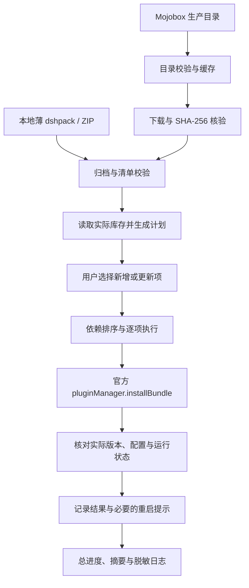

# Mojobox Installer 架构

本项目是官方 DeepSeek Harness 的设置页插件，包名为 `dsh-plugin-mojobox`。
目录和整合包内容由 [Mojobox 主仓库](https://github.com/lanyun077/EAC-mojobox)维护，
依赖解析、实际安装与运行由官方宿主提供。安装器只组织经用户确认的计划，不实现另一套插件运行时。

## 安装链路

核对更新先刷新远端目录，有新版则下载核验并生成新预览，无新版则明确提示并重新核对原目标。
失败项重试依据已有记录生成选择计划，不直接重放写入。提交时和每次写入前重新读取实际状态，避免预览后环境变化。

## 源码分工

| 模块 | 责任 |
| --- | --- |
| `src/client.ts` | 宿主 React 设置页；导入、发现、选择、请求反馈、总进度与日志入口 |
| `src/index.ts` | 宿主初始化、当前 Profile 接线、Connection 路由注册与请求边界 |
| `src/contracts.ts` | 实际使用的官方服务接口最小类型，不替代官方 SDK 定义 |
| `src/feature-pack.ts` | 内存读取 ZIP、Schema 与语义校验、尺寸和成员限制 |
| `src/catalog.ts` | 固定目录读取、版本身份、缓存、新版识别与归档一致性 |
| `src/artifacts.ts` | 解析宿主配置的注册表、精确产物、SHA-512 与 tarball 身份核验 |
| `src/manager.ts` | 库存分类、计划、选择执行、依赖关系、配置保护核验、记录与诊断 |
| `schema/feature-pack.json` | 主仓协议的本地副本，来源见同目录 README |
| `scripts/build.mjs` | TypeScript 转换及官方前端模块工厂输出到 `lib/` |

宿主从 `cordis.patch.yml` 注册 `lib/index.js`；客户端通过包导出 `./client` 加载，React 复用宿主。
不修改官方客户端安装文件，也不复制 SDK、宿主可执行文件或用户 Profile 到仓库。

## 执行与失败语义

- 预览最多四项并发核验，保持清单顺序；安装写入串行执行，避免并发修改同一 Profile。
- 同版本直接复用；高版本保留；已停用组件不自动开启；非托管本地链接不自动更新。
- 更新使用已核验 tarball 调用官方 `installBundle`，保留更新前的 bundle 选择与逐入口启停，不先删除旧版。
- 明确依赖先执行；依赖未选或失败使关联项跳过，独立项可继续，不擅自扩大选择。
- 普通失败仅在官方恢复结果、配置与实际版本均可确认时继续；结果不明或保护配置变化时暂停后续写入。
- 不提供包级全有或全无事务，也不承诺回滚第三方插件自身的数据迁移。中断记录保留，不自动续装。

## 宿主路由

路径前缀为 `/api/mojobox/`。全部使用官方 Connection 的认证、信任检查及 owner 权限，
没有匿名安装接口。路由不是面向公网的独立 HTTP 服务。

| 方法 | 路由 | 作用 |
| --- | --- | --- |
| GET | `status` | 当前任务、精简库存、运行状态与历史记录 |
| POST | `preview` | 提交薄包字节并生成预览 |
| POST | `start` | 使用服务端计划 ID 与所选引用开始任务 |
| POST | `replan` | 按已有记录重新核对或仅预选失败项 |
| GET | `catalog` | 读取当前目录快照 |
| POST | `catalog-refresh` | 刷新固定远端目录 |
| POST | `catalog-preview` | 按目录 ID 和版本下载、核验并生成计划 |
| POST | `save-log` | 保存已有任务或当前状态的脱敏诊断 |

客户端不能提交任意下载 URL、shell 命令、安装 spec 或日志输出路径。
保存日志只接受现存任务 ID 与有限错误上下文，文件名和存储位置由服务端生成。

## 数据目录

所有持久数据位于**当前 Profile** 的 `.mojobox-manager/`：

| 路径 | 用途与维护限制 |
| --- | --- |
| `records.json` | 任务历史与目标清单；重启后结合实际库存核对，不把历史成功等同于当前已满足 |
| `catalog.json` | 上次有效目录、检查时间和已核验版本身份；刷新失败保留旧展示并提示 |
| `artifacts/` | 经校验的更新产物；可能仍被宿主 pnpm 的本地来源引用，不应作为临时缓存随意删除 |
| `logs/` | 用户主动保存的脱敏 JSON 日志，不导出个人配置或账号数据 |

目录缓存不提供离线归档安装，重启后用于远端安装前仍须成功刷新。
恢复测试初态需要客户端退出后还原整个测试 Profile；仅删除安装器记录不会撤销已安装插件或恢复配置。

## 协议与兼容

- 薄包沿用 `formatVersion: 1`、根 `pack.json`，制作与收录规范以
  [Mojobox 主仓库](https://github.com/lanyun077/EAC-mojobox/blob/main/docs/intake.md)为权威来源。
- Schema 副本来源见 [schema/README.md](../schema/README.md)。历史 `x-eac` 字段和 Schema 标识是数据协议遗留，
  不引入 EAC 客户端或运行时依赖，不在此仓库自行修改上游字段。
- 当前远端入口为 `https://lanyun077.github.io/EAC-mojobox/generated/catalog.json`，
  接受 `catalog.mojobox.dev/v1alpha1`、`mode: intake`、`demo: false`。
  下载仅限同站部署根的 `generated/downloads/`，核对大小、SHA-256、包身份与组件声明。
- 同 ID、同版本的已核验摘要不允许悄悄变化；远端移除条目不删除本地组件。
- 注册表来自官方服务当前配置；更新产物要求 HTTPS 和 SHA-512，不跳转来源或回落到公共注册表。
  HTTP 仅限本机回环测试。

涉及协议变化时先在主仓明确格式与版本，再在本仓更新消费者、Schema 来源和正反例；
安装器与目录独立发布，不要求普通内容更新伴随安装器发版。
官版接口变化需要更新本仓契约与验证记录，不能以放宽版本检查冒充适配。

## 构建与仓库边界

`src/` 为事实源，`lib/` 为生成物；`npm test` 先构建，`npm pack` 打包已构建文件。
发行文件由 `package.json.files` 限定为 `lib/`、注册 patch、README 和 Schema，加上 npm 自动纳入的包元数据与许可证。
测试、样本、个人指引、本机报告及桌面调试工具不随插件分发。
CI 只做构建、类型检查、测试与打包检查，不发布 npm、Release 或网站。
